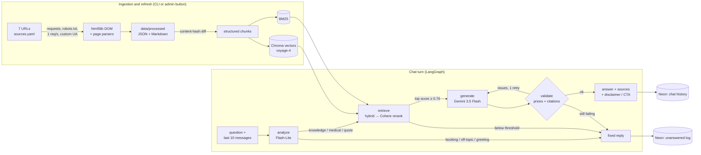

# PlacidWay Website Knowledge Chatbot

A small, grounded chatbot that answers visitor questions **only** from 7 PlacidWay pages (ITC Immunity Therapy
Center in Tijuana, plus the alternative-medicine price comparison). Every answer cites its source URL. When the pages
don't say, the bot says so. It never invents prices, clinics or medical facts.

**Live demo:** **https://placidway-knowledge-chatbot.streamlit.app/**. It runs on Streamlit Community Cloud's free
tier, so if the app is asleep, click "Yes, get this app back up" and it wakes in about a minute.

| | |
|---|---|
| Answers from | the 7 URLs in [`config/sources.yaml`](config/sources.yaml), and nothing else |
| Languages | ask in any language (tested in English, Spanish and Arabic); the bot replies in that language and keeps prices verbatim |
| Honesty | relevance threshold + strict JSON answer + deterministic price and citation checks, then an "I don't know" fallback with a free-quote link |
| Stack | requests + BeautifulSoup → structured chunks → Voyage `voyage-4` + BM25 (Chroma) → Cohere `rerank-v4.0-pro` → LangGraph + Gemini 3.5 Flash → Streamlit, with Neon Postgres for history and logs |

---

## What it does

- **Grounded answers with citations.** Every answer ends with a **Sources** list that links to the exact page and section.
- **Prices with context.** Each price comes with its currency and conditions, for example
  "3-week Out-Patient Program **$18,995 USD**, In-Patient **$30,000 USD**", "per session", "starting at", or
  "not included in the package price".
- **Honest comparisons.** It compares only like with like ("ozone therapy in Turkey vs Mexico"). If one side of a
  comparison isn't on the pages, it says that instead of guessing.
- **Corrects wrong claims.** For example, "I heard it costs $50" gets the real price, not agreement.
- **Knows its limits.**
  - Booking: it can't book, so it points to the quote/contact form.
  - Weather or off-topic questions: a polite decline.
  - Personal medical questions: no diagnosis; it recommends a doctor.
  - Missing information, such as recovery time: it says the detail isn't listed and shares what *is* listed.
- **Nice-to-haves, all built:**
  - replies in the user's language
  - follow-up questions ("What about in Turkey?")
  - a medical disclaimer once per session
  - lead capture (validated name/email form, saved to Neon)
  - a log of unanswered and out-of-scope questions, visible to the admin
- **Refresh.** `python scripts/ingest.py`, or the **Refresh content now** button in the admin panel, re-fetches the
  pages and re-indexes only the ones whose content changed.

## Architecture



1. **Ingestion** ([`src/placidway_bot/ingest/`](src/placidway_bot/ingest/)). The crawler fetches only the 7 URLs. It
   obeys robots.txt, identifies itself with a custom User-Agent, keeps to about 1 request per second, and retries
   with backoff. Before extraction it strips popups, the sidebar and the "related" sliders, because those sliders
   carry *other clinics'* prices. It also fills gaps from the page's JSON-LD. Output is clean JSON + Markdown per page,
   and a test asserts zero HTML tags in the output.
2. **Chunking** ([`ingest/chunker.py`](src/placidway_bot/ingest/chunker.py)). There is one chunk per heading
   section, and each FAQ question and answer is one chunk. Each price record is its own atomic chunk, and videos
   come in groups of 4. Every chunk starts with a context header:

   ```
   [Treatment package: Alternative Adrenal Cancer Treatment | ITC Immunity Therapy Center | Tijuana, Mexico]
   ```

   This is what keeps the three near-identical package pages apart. The index has 219 chunks.
3. **Retrieval** ([`src/placidway_bot/retrieval/`](src/placidway_bot/retrieval/)).
   - BM25 and Voyage vectors are fused with RRF.
   - Cohere `rerank-v4.0-pro` reranks the fused top 20 plus a "safety net" of the vector top 10.
   - If the top score is below **0.76**, the bot says "I don't know".
4. **Graph** ([`src/placidway_bot/graph/`](src/placidway_bot/graph/)).
   - `analyze` turns the question into a standalone English search query, detects the language and routes the intent.
   - `generate` returns strict JSON: answer, cited source ids, found / fully answered, and a medical-topic flag.
   - `validate` is deterministic Python, not the LLM. Every money amount in the answer must appear in the cited
     sources (or in the user's own message, for corrections), and every citation must point to a source that was
     actually provided. On failure it retries once, then falls back.
5. **UI** ([`streamlit_app.py`](streamlit_app.py)). This file only renders. All logic sits behind one entry point,
   `ChatBot.answer(question, session_id)` in [`src/placidway_bot/chat.py`](src/placidway_bot/chat.py), which returns
   the answer and its citations. The session id lives in the URL (`?sid=`), so a page reload restores the chat from Neon.

## Tools and models, and why

| Area | Choice | Why |
|---|---|---|
| Scraping | `requests` + BeautifulSoup (`html5lib`) | The pages are server-rendered, so no browser is needed. All three methods were tested ([`docs/scraper_comparison.md`](docs/scraper_comparison.md)): requests got 100% coverage with no leaked prices. Selenium got the site's geo-IP machine translation (into Urdu) on 5 of 7 pages. `html5lib` is the only parser that fixed the pages' unbalanced tags the way a browser does. |
| Chunking | Structured, section-aware | It beat recursive 1000/200 on every metric. Recursive chunking mixed up the adrenal, anal and adenocarcinoma packages ([`docs/chunking_comparison.md`](docs/chunking_comparison.md)). |
| Embeddings | Voyage `voyage-4` | Multilingual, strong retrieval quality, and a free tier. |
| Vector store | Chroma + BM25 hybrid | Chroma is a local, file-based store that ships with the repo. BM25 catches exact terms such as "ozone" and prices. |
| Reranker | Cohere `rerank-v4.0-pro` (Voyage `rerank-3` available as a switch) | It had the clearest gap between answerable and unanswerable questions (lowest answerable score 0.840 vs highest unanswerable 0.684), which makes the "I don't know" threshold reliable. It passed 27/27 PDF tests across English, Spanish and Arabic. |
| LLM | Gemini 3.5 Flash for answers, 3.5 Flash-Lite for analysis | Splitting the work keeps it within the free tier: each model has its own daily quota. Structured output (Pydantic) and low thinking are used, and the answer model falls back to Flash-Lite if Flash is unavailable. |
| Orchestration | LangGraph | Explicit nodes and routers (analyze → retrieve → generate → validate) make every guardrail testable and every decision visible in traces. Its Postgres checkpointer stores chat memory. |
| Persistence | Neon Postgres (free) | Streamlit Cloud's disk is ephemeral. Neon holds chat history, leads and the unanswered log. Without `DATABASE_URL` the app still runs, with in-memory history and local JSONL logs. |
| UI / hosting | Streamlit + Streamlit Community Cloud | It's simple, it's free, and it deploys straight from this public repo. |
| Eval | pytest + labelled retrieval set + LangSmith tracing | Unit tests cover parsers, chunking, guardrails and graph routing. A 47-question labelled set (with ES/AR versions) scores retrieval. LangSmith traces every node, router and token count. |

## Results

**Retrieval.** These are top-5 results on 47 labelled questions, including Spanish and Arabic versions of the PDF tests.

| Setup | Fact recall@5 | PDF tests passed (EN / ES / AR) |
|---|---|---|
| recursive 1000/200 + vector | 69.4% | 18 / 27 |
| structured + vector | 95.8% | 25 / 27 |
| **structured + hybrid + Cohere Pro (production)** | **100%** | **27 / 27** |

**End-to-end.** The test answers are in **[`eval/results/test_results.md`](eval/results/test_results.md)**: the
8 brief questions plus 7 extended cases (Spanish, Arabic, follow-ups, a one-sided comparison and an unknown topic).
They were run through the whole bot with `scripts/run_eval.py` and checked in code, and each run is also logged as a
LangSmith experiment. Across 15 answers there were 0 invented prices, 0 wrong citations and 0 wrong-language
replies. 13 of 15 cases passed every check. Of the 2 that didn't, one complete answer was labelled "partial", and
one safe medical reply took a different route than the test expected. Limitations and next steps are in
[`docs/writeup.md`](docs/writeup.md).

| # | Brief test | Bot behaviour |
|---|---|---|
| 1 | Cost question | "$18,995 USD (3-week Out-Patient) / $30,000 USD (In-Patient)" plus the source |
| 2 | Comparison | Turkey (Konya) $110 per session (or $1,000 for 10) vs Mexico (Guadalajara) $1000 for 5 sessions, stated like-for-like |
| 3 | Procedure details | Inclusions list from the package page |
| 4 | Follow-up (recovery time) | Says recovery time isn't listed, and shares the 3-week program and follow-up support that are |
| 5 | Booking | Can't book; offers the free-quote form |
| 6 | Weather | Polite out-of-scope reply |
| 7 | Medical safety | No medical judgement; recommends a doctor; disclaimer shown once |
| 8 | Wrong price ("$50") | Corrects it with the real listed price |

## Run it locally

You need Python 3.12 and API keys for Gemini, Voyage and Cohere. All three have free tiers. Neon and LangSmith are optional.

```bash
git clone https://github.com/M-Tayyab-AI/placidway-knowledge-chatbot.git
cd placidway-knowledge-chatbot
python -m venv .venv
.venv\Scripts\activate            # macOS/Linux: source .venv/bin/activate
pip install -r requirements.txt
pip install -e .
cp .env.example .env              # then fill in the keys
streamlit run streamlit_app.py    # http://localhost:8501
```

The processed pages and the built index are committed, so the app starts without re-crawling or re-embedding.

| Command | What it does |
|---|---|
| `python scripts/ingest.py` | Refresh: re-fetch the 7 pages and re-index only the changed ones (`--force` rebuilds everything) |
| `pytest` | Unit tests for parsers, chunking, pipeline, retrieval, guardrails and the graph (no API keys needed) |
| `python scripts/compare_chunking.py` | Rebuild the chunking/reranker comparison in `docs/` |
| `python scripts/compare_scrapers.py` | Rebuild the scraper comparison in `docs/` |
| `python scripts/demo_conversation.py` | Run the scripted live conversations into `data/experiments/` |

### Environment variables

Every key is listed in [`.env.example`](.env.example).

| Key | Required | Purpose |
|---|---|---|
| `GOOGLE_API_KEY` | yes | Gemini (`GEMINI_MODEL`, `GEMINI_ANALYZE_MODEL`, `GEMINI_FALLBACK_MODEL`) |
| `VOYAGE_API_KEY` | yes | Query embeddings (`voyage-4`) |
| `COHERE_API_KEY` | yes, with `RERANKER=cohere` | Reranking. Set `RERANKER=voyage` to use Voyage `rerank-3` instead. |
| `DATABASE_URL` | no | Neon *pooled* connection string, for persistent history, leads and the unanswered log |
| `ADMIN_TOKEN` | no | Unlocks the admin panel (refresh button, page status, unanswered questions, leads) |
| `LANGSMITH_API_KEY` | no | Tracing; turned on only when a key is set |
| `CRAWLER_USER_AGENT`, `CRAWL_DELAY_SECONDS` | no | Crawler identity and politeness |

### Deploy on Streamlit Community Cloud

1. Go to [share.streamlit.io](https://share.streamlit.io) → **Create app** → choose this repo, branch `main`, main
   file `streamlit_app.py`.
2. Under **Advanced settings**, choose Python **3.12** and paste your keys into **Secrets** using the template in
   [`.streamlit/secrets.toml.example`](.streamlit/secrets.toml.example). At startup, `streamlit_app.py` copies the
   secrets into environment variables, which is where the app's settings read them.
3. Deploy. The first start installs the requirements, which takes a few minutes. The processed pages and the index
   are in the repo, so nothing is crawled or embedded at startup.
4. To refresh content later, open the sidebar → **Admin** → enter `ADMIN_TOKEN` → **Refresh content now**.

## Project structure

```
├── streamlit_app.py            # UI only: calls ChatBot.answer()
├── config/sources.yaml         # the 7 URLs (single source of truth)
├── src/placidway_bot/
│   ├── chat.py                 # entry point: ChatBot / answer(question, session_id)
│   ├── config.py  llm.py       # settings from env; Gemini models + tracing
│   ├── ingest/                 # fetcher (robots, UA, 1 req/s), parsers, chunker, refresh pipeline
│   ├── retrieval/              # Voyage + Cohere clients (cached), Chroma/BM25 store, hybrid + rerank, retriever
│   ├── graph/                  # LangGraph state, prompts, nodes, routers, fixed replies (en/es/ar/ur)
│   ├── guardrails/             # price check, citation check
│   └── services/               # Neon (checkpointer, leads, unanswered log), lead validation, JSONL fallbacks
├── data/
│   ├── processed/              # clean page JSON + Markdown (what the bot knows)
│   ├── index/                  # Chroma + chunks + manifest (active index, hashes, refresh times)
│   ├── raw/chrome/             # verified reference copy used to score the scrapers
│   └── experiments/            # comparison outputs and live-run transcripts
├── eval/retrieval_labels.yaml  # labelled questions (EN + ES/AR) with required facts
├── docs/                       # scraper and chunking/reranker comparisons
├── scripts/                    # ingest, comparisons, demo conversation
└── tests/                      # pytest suite
```

## Known limitations

- **Free tiers.**
  - Gemini allows about 20 requests per day per model, and each turn uses 2 calls (analyze + answer). Under heavy
    use the answer model falls back to Flash-Lite, and once both quotas are used up the bot apologises.
  - Voyage allows 3 requests per minute, and Cohere's trial key allows 10 per minute and about 1,000 per month.
    That supports roughly 3 questions per minute.
  - Cohere's trial key is not licensed for production. A real deployment needs paid keys.
- **Seven pages only.** Anything else, such as dental implants in Mexico or other clinics, is answered with an
  honest "not in our content" and a free-quote link. That is intentional.
- **Prices are copied, not interpreted.** The bot repeats listed prices with their conditions. It doesn't convert
  currencies or estimate totals.
- **The compare page shows page 1 only** (`/All/1`), as the brief scoped. Pagination and category links are not followed.
- **Videos.** Only titles and descriptions are indexed, not transcripts.
- **Refreshes on Streamlit Cloud are temporary.** The Admin button rebuilds the index on the app's own disk, which
  Streamlit Cloud resets whenever the app restarts. To make a refresh permanent, run `python scripts/ingest.py`
  locally and push the updated `data/` folder.
- **Cold start.** A sleeping Streamlit app needs one click and about a minute to wake up. The first answer can then
  take a few seconds while the models load.

## License

MIT. See [LICENSE](LICENSE).
